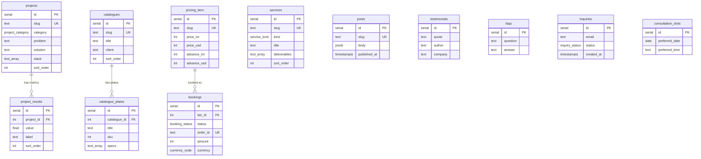

# Database

PostgreSQL via **Drizzle ORM**. Source of truth: [`src/db/schema.ts`](../src/db/schema.ts).

```
src/db/
  schema.ts   tables · enums · indexes · relations      ← edit this
  index.ts    pg Pool + drizzle client (schema attached → db.query.* works)
  seed.ts     fills CONTENT tables from src/data/siteData.ts
drizzle/      generated SQL migrations (commit these)
drizzle.config.json
src/lib/content.ts   the only place pages read content from (DB first, bundled fallback)
```

## Entity relationship



## Two groups of tables

| Group | Tables | Notes |
| --- | --- | --- |
| **Content** | `services`, `projects`, `project_results`, `catalogues`, `catalogue_plates`, `posts`, `testimonials`, `pricing_tiers`, `faqs` | Ordered by explicit `sort_order` (not `created_at`). Hidden with `published = false`. |
| **Operations** | `inquiries`, `bookings`, `consultation_slots` | Written by visitors, read only in `/admin`. No public GET endpoints. |

## Rules enforced by the database

- `consultation_slots (preferred_date, preferred_time)` is **unique** → a call slot can't be double-booked, even under concurrent requests.
- `bookings.order_id` is **unique** → one Razorpay order maps to one booking.
- `bookings.tier_id → pricing_tiers.id` is `ON DELETE SET NULL`; `tier_name` is a snapshot so billing history survives edits.
- `project_results` and `catalogue_plates` are `ON DELETE CASCADE` from their parent.
- Closed sets are enums: `inquiry_status`, `booking_status`, `booking_mode`, `currency_code`, `project_category`, `service_kind`.
- A booking is **never** marked `paid` by the client. Only `/api/payments/verify` (HMAC signature) or `/api/payments/webhook` can do that.

## Commands

```bash
npx drizzle-kit push                 # apply schema to the dev database
npx drizzle-kit generate             # write a SQL migration into ./drizzle
npx tsx src/db/seed.ts               # seed empty content tables
npx tsx src/db/seed.ts --reset       # wipe + re-seed content (never touches operations tables)
```

## Content flow

`page.tsx` → `getProjects()` etc. in `src/lib/content.ts` → Postgres.
If the DB is down or a table is empty, the same function returns the bundled copy in
`src/data/siteData.ts`, so the site always renders. To change copy, edit the rows
(or `siteData.ts` + `--reset`).

## Admin

`/admin` is an inbox for the operations tables (enquiries, bookings, call requests). It is disabled
until `ADMIN_PASSWORD` (8+ characters) is set in the environment.
